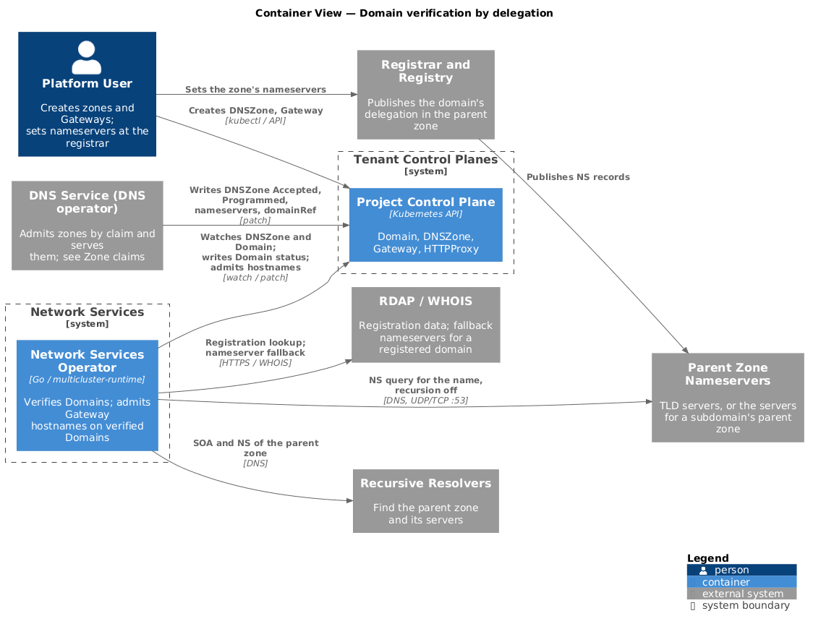
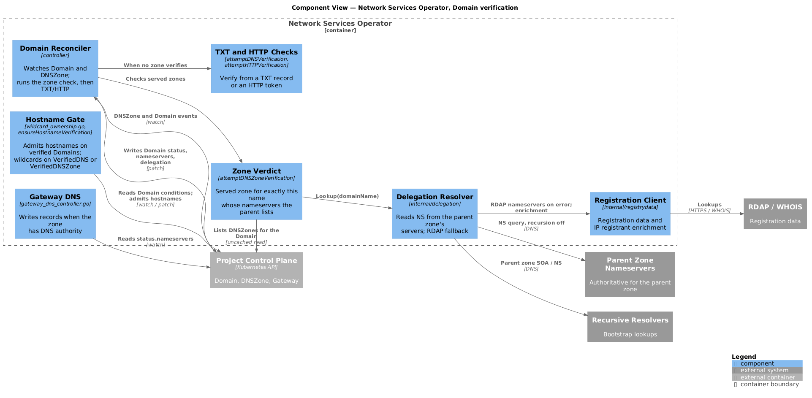
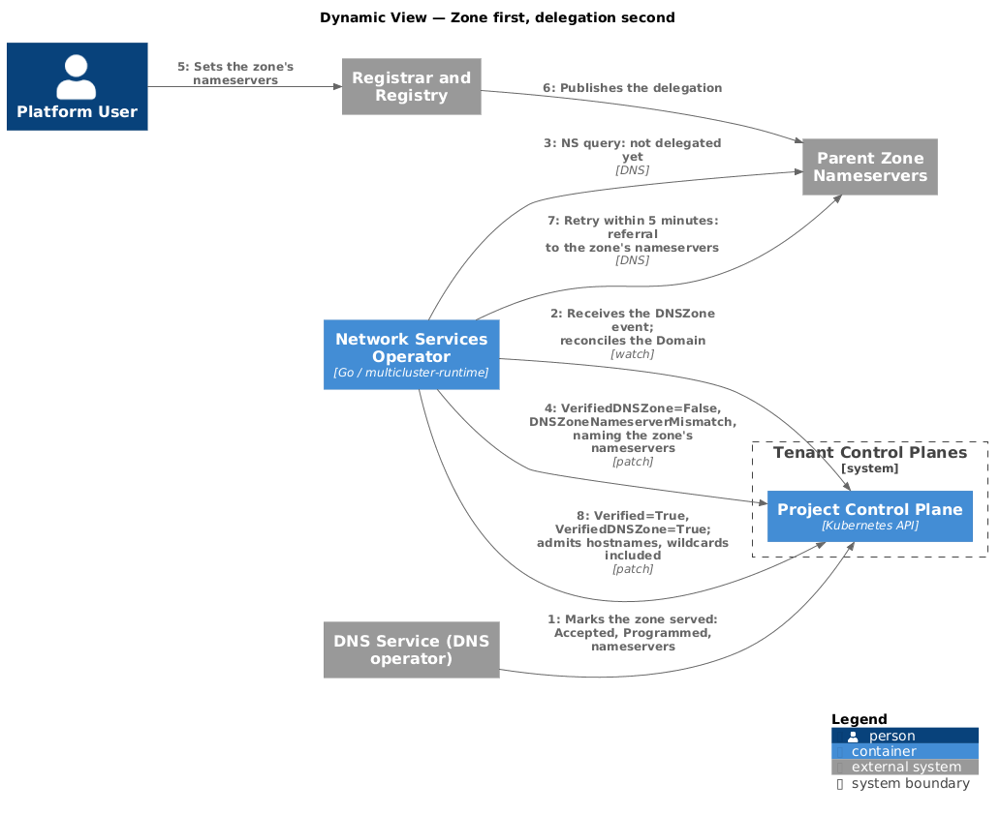

# Domain verification by delegation

- [Summary](#summary)
- [Container view](#container-view)
- [Components](#components)
- [The verdict](#the-verdict)
- [Reading a delegation](#reading-a-delegation)
- [When lookups run](#when-lookups-run)
- [Status](#status)
- [Wildcard hostnames](#wildcard-hostnames)
- [Delegated before the zone](#delegated-before-the-zone)
- [Configuration](#configuration)
- [Signals](#signals)
- [Testing](#testing)
- [Limitations](#limitations)

## Summary

A `Domain` is verified without a TXT record when the project's own zone for it
is served and the domain's parent delegates it to that zone's nameservers. The
order doesn't matter: the zone can be created before or after the delegation.

The `Domain` controller:

- Watches `DNSZone`, so a zone becoming served triggers a check immediately.
- Reads the delegation from the parent zone's authoritative servers on every
  check.
- Counts only zones that are served. The DNS operator decides which zone
  serves, with claims. See [Zone claims][dns-design].

Wildcard hostnames accept this verdict as proof, as they accept a TXT record.

The verdict is about domain ownership only. Certificate validation, including
the `_acme-challenge` record for a wildcard certificate, is separate. A
hostname whose DNS is hosted elsewhere is verified by TXT or HTTP.

Each behavior is off until an environment turns on its setting, so a release
that contains it changes nothing on its own. See
[Configuration](#configuration).

## Container view

<p align="center">
  
</p>

This operator never writes to the DNS operator's resources, and the DNS
operator never reads a `Domain` condition. Each operator reads only the other's
status, so neither waits on its own output.

## Components

<p align="center">
  
</p>

| Component | Code | Responsibility |
|-----------|------|----------------|
| Domain reconciler | `internal/controller/domain_controller.go` | Watches `Domain` and `DNSZone`. Runs the zone check, then TXT and HTTP. |
| Zone verdict | `attemptDNSZoneVerification` | Decides `VerifiedDNSZone` from served zones and the delegation. |
| Delegation resolver | `internal/delegation` | Reads delegations from the parent zone's servers, with an RDAP fallback. |
| TXT and HTTP checks | `attemptDNSVerification`, `attemptHTTPVerification` | Verify a `Domain` from a TXT record or an HTTP token. |
| Registration client | `internal/registrydata` | Registration data, RDAP nameservers for the fallback, and IP registrant enrichment. |
| Hostname gate | `wildcard_ownership.go`, `gateway_controller.go`, and its copy in `internal/cmd/alb/spec/verification.go` | Admits a hostname on a verified `Domain`, and a wildcard on `VerifiedDNS` or `VerifiedDNSZone`. |
| Gateway DNS | `gateway_dns_controller.go` | Writes records when the zone has DNS authority, from `status.nameservers`. |

## The verdict

With `domainDelegation.enabled` on, `VerifiedDNSZone` is `True` when a zone `Z`
exists such that:

1. `Z` is in the `Domain`'s namespace and `Z.status.domainRef.name` is the
   `Domain`'s name.
2. `Z.spec.domainName` equals `Domain.spec.domainName`. A zone for a child
   name never verifies its parent.
3. `Z` is `Accepted=True` and `Programmed=True`. The DNS operator sets these
   only when the zone's claim is `Active` and the zone is served. A zone held
   for verification doesn't count.
4. The delegation for `Domain.spec.domainName` lists at least one hostname in
   `Z.status.nameservers`. A partial delegation, or one that mixes in another
   provider, counts.

When it's `True`, `Verified` is `True`, and it stays `True`.

Rule 3 is the control the verdict depends on, and the DNS operator enforces it.
The claim decides whether a zone serves. If the DNS operator's verification
gate is on, no zone serves before verification, so this verdict is never
reached. If tenants could write `DNSZone` status, they could fake rule 3. The
DNS operator's [contract][dns-contract] guarantees neither happens.

## Reading a delegation

The delegation resolver answers one question: which nameservers does the
internet use for this name, according to the zone above it? It talks DNS
directly with `github.com/miekg/dns`, not through `net.DefaultResolver`.

```go
type Delegation struct {
    Name        string    // the queried name: lowercase, no trailing dot
    Cut         string    // the zone cut whose NS set serves Name; "" if Name doesn't exist
    Nameservers []string  // lowercase hostnames, no trailing dot, sorted
    Source      Source    // SourceParent or SourceRDAP
    ObservedAt  time.Time
}

type Resolver interface {
    Lookup(ctx context.Context, name string) (Delegation, error)
}
```

To look up `N`:

1. Ask the configured recursive resolvers for the SOA of `N`'s parent. The
   owner of the SOA in the answer or authority section is the enclosing zone,
   `P`.
2. Ask for `P`'s NS set and the addresses of those servers.
3. Send `N NS` with recursion off to up to `parentServerAttempts` of `P`'s
   servers, one at a time, falling back to TCP on truncation. Use the first
   usable response:

   | Response | Result |
   |----------|--------|
   | A referral: NS for `N` in the authority section | `Cut = N`, nameservers from the referral |
   | An authoritative answer with NS for `N`, because the same server hosts both zones | `Cut = N`, nameservers from the answer |
   | Authoritative NODATA, with `P`'s SOA | No cut at `N`. `Cut = P`, nameservers are `P`'s. |
   | Authoritative NXDOMAIN | `N` doesn't exist. `Cut = ""`, no nameservers. |
   | SERVFAIL, REFUSED, timeout, or a lame answer from every server | An error. See below. |

4. On an error for a registered domain, fall back to the RDAP nameservers from
   the registration client, with `Source = SourceRDAP`. For any other name, or
   if RDAP has no answer, return a `*LookupError`.

For a registered domain, `P` is the TLD's zone, so the answer comes from the
registry's servers, including for TLDs with no RDAP service. For a subdomain
such as `shop.example.com`, `P` is the zone for `example.com`, wherever it's
hosted.

The NODATA case is how a subdomain with no zone cut of its own works: it's
served by its parent's nameservers, so it's delegated to the platform only if
its parent is. That's safe only because the DNS operator refuses a zone for a
name under another project's zone. See [Zone claims][dns-design].

A `*LookupError` never changes `status.nameservers` or any condition that's
already `True`. It's reported in `status.delegation.lastLookupError` and on the
`VerifiedDNSZone` condition while the `Domain` is unverified.

## When lookups run

<p align="center">
  
</p>

With `domainDelegation.enabled` on:

- **While the `Domain` is unverified and a served zone exists for it:** on
  every `DNSZone` event, and every `domainDelegation.pendingCheckInterval`
  after that, independent of the TXT and HTTP retry intervals. Those intervals
  belong to the deployment and can stretch to hours, so they never decide how
  soon a delegation is noticed. A customer who delegates days after creating
  the zone is verified within `pendingCheckInterval` of the change reaching the
  parent's servers.
- **Otherwise:** every `domainDelegation.refreshInterval`, so Gateway DNS sees
  delegation changes within the hour.
- A per-name cache of `domainDelegation.cacheTTL` keeps a burst of events from
  becoming a burst of queries.

The `Domain` controller watches `DNSZone` in each project control plane. A zone
event enqueues the `Domain` in the zone's namespace whose `spec.domainName`
equals the zone's, so the zone reaches its `Domain` even before
`status.domainRef` is set. The predicate passes changes to `Accepted`,
`Programmed`, `status.nameservers`, and `status.domainRef`.

Registration data refreshes on its own schedule,
`domainRegistration.refreshInterval`, and the delegation doesn't depend on it.

## Status

### Nameservers

The delegation resolver writes `status.nameservers`. IP registrant enrichment
fills `ips[].registrantName`. A failed or rate-limited enrichment keeps the
hostname with no IPs; it never drops a delegated hostname.

### Delegation

`status.delegation` exposes the facts behind the verdict:

```yaml
status:
  delegation:
    zoneCut: example.com
    source: Parent          # Parent or RDAP
    lastObservedTime: "2026-10-26T18:02:11Z"
    lastLookupError: ""     # set on a failed lookup; previous facts are kept
```

### Conditions

`VerifiedDNSZone` reasons:

| Reason | When | Message tells the customer |
|--------|------|----------------------------|
| `DNSZoneNotFound` | No zone in the namespace for this name | To create a zone, or verify another way |
| `DNSZoneNotReady` | The zone exists but isn't `Accepted` and `Programmed`, including a contested zone | The zone's own `Accepted` message |
| `DNSZoneNameserverMismatch` | The zone is served but the parent doesn't delegate to it | The zone's nameservers to set at the registrar, and what the parent lists now |
| `DelegationLookupFailed` | The lookup failed | That the check will retry, and the error |
| `Verified` | The verdict holds | That the domain is verified by delegation |

While a served zone exists, `Verified=False` says to delegate the domain to the
zone's nameservers, or to publish the TXT record as an alternative. The TXT and
HTTP challenge stays in `status.verification` so a customer who keeps DNS
elsewhere can use it.

## Wildcard hostnames

With `domainDelegation.wildcards` on, `provenByDNS` is
`Verified && (VerifiedDNS || VerifiedDNSZone)`. `unverifiedReason` in
`internal/cmd/alb/spec/verification.go` applies the same rule, and
`verificationMethodPhrase` describes a zone-verified `Domain` as proof for
wildcards. With it off, a wildcard needs `VerifiedDNS`.

A project whose served zone the parent delegates to already answers every name
under the domain, so it could get a wildcard certificate from any public CA. An
HTTP-verified `Domain` doesn't prove a wildcard.

## Delegated before the zone

A domain delegated to the platform before any zone exists goes to whoever
creates the zone first. The reconciler makes that case visible: when the first
delegation lookup after the zone became served already matches it, it emits a
`DelegatedBeforeZone` event on the `Domain` and increments a counter.
Operators alert on the counter and review each case.

The signal also fires for every customer who delegates first on purpose, so
it's for review, not for blocking. It's an event and a metric, not a
condition, because a customer-visible condition that usually means nothing is
wrong would confuse more than it helps.

## Configuration

The `domainDelegation` section of the server config. Every default keeps the
behavior from before verification by delegation, so each behavior stays off
until an environment turns on its setting.

| Field | Default | Description |
|-------|---------|-------------|
| `enabled` | `false` | Read delegations from the parent zone, watch `DNSZone`, and use the verdict above. Off: nameservers come from the registration refresh, and the zone check counts a zone held for verification at a registered domain. |
| `wildcards` | `false` | Accept `VerifiedDNSZone` as proof for wildcard hostnames. |
| `resolvers` | The system resolvers | Recursive resolvers used to find the parent zone and its servers. The end-to-end suite points this at a test parent. |
| `pendingCheckInterval` | `1m` | How often an unverified `Domain` with a served zone is rechecked |
| `refreshInterval` | `1h` | How often a delegation is re-read when no check is pending |
| `cacheTTL` | `30s` | How long a lookup result is reused |
| `queryTimeout` | `2s` | Timeout for each query to a parent server |
| `parentServerAttempts` | `3` | How many parent servers to try before failing |

Turn on `wildcards` only after `enabled`, and only once the DNS operator serves
zones before verification. See
[Turning off the verification gate][dns-gate].

The operator needs outbound UDP and TCP on port 53 to arbitrary addresses to
reach parent servers.

## Signals

- Delegation lookups by public suffix, source, and result (`delegated`,
  `not_delegated`, `error`). The error rate per suffix exposes a registry whose
  servers or RDAP service are failing.
- Time from a zone becoming `Programmed` to its `Domain` being verified by
  delegation, for a domain already delegated. This is the SLO for
  served-and-verified.
- `DelegatedBeforeZone` count.

## Testing

Unit tests:

- The delegation resolver against an in-process `miekg/dns` server playing the
  parent: a referral, an authoritative NS answer, NODATA, NXDOMAIN, truncation,
  SERVFAIL from one server then success from the next, and every server
  failing.
- The verdict as a table. Each row that should refuse must refuse:

  | Zone | Delegation | `VerifiedDNSZone` |
  |------|------------|-------------------|
  | Served, same name | Lists one of its nameservers | `True` |
  | Served, same name | Lists none | `False`, `DNSZoneNameserverMismatch` |
  | Contested (`Accepted=False`, `DNSZoneInUse`) | Lists its nameservers | `False`, `DNSZoneNotReady` |
  | Held for verification | Lists its nameservers | `False`, `DNSZoneNotReady` |
  | Served, for a child name | Lists its nameservers | `False`, `DNSZoneNotFound` |
  | Served, same name | Lookup error, last known lists it | Unchanged, `DelegationLookupFailed` |

- Wildcards: accepted with `VerifiedDNSZone`; refused with `VerifiedHTTP` only;
  refused while unverified.
- A rate-limited enrichment keeps every hostname.

The end-to-end cases run in the DNS operator's suite with this operator
deployed (`NSO_DEPLOY=true`), because they need both operators and two project
control planes. A test parent, an authoritative server for the `test.` TLD that
the suite can rewrite, stands in for a registry, and `domainDelegation.resolvers`
points at it. Each case asserts both the condition and what the platform's
nameservers answer.

| Case | Must observe |
|------|--------------|
| Delegate first | The parent delegates `example.test` before the zone exists. The zone is answered, and the `Domain` is `Verified` by `VerifiedDNSZone` with no TXT record published, within the SLO. |
| Zone first | The zone is answered and the `Domain` reports `DNSZoneNameserverMismatch` naming the zone's nameservers. After the suite changes the delegation, it's `Verified` within `pendingCheckInterval`, with the TXT and HTTP retry intervals set to hours. |
| Contested zone refused | A second project's contested zone for `example.test`, with the delegation pointing at the platform, and a `Domain` created by hand: it stays unverified. |
| Subdomain, parent elsewhere | The test parent hosts `example.test` and delegates `shop.example.test` to the platform. The `shop.example.test` zone verifies. |
| Subdomain, no cut | A zone for `shop.example.test` whose parent has no cut for it and isn't delegated to the platform stays unverified. |
| Lookup failure | With the test parent stopped, a verified `Domain` stays verified, `status.nameservers` is unchanged, and an unverified one reports `DelegationLookupFailed`. |
| Wildcard | A Gateway hostname `*.example.test` is accepted for a `Domain` verified only by delegation, and refused for one verified only over HTTP. |

## Limitations

| Limitation | Effect |
|------------|--------|
| A dangling delegation verifies whoever creates the zone first. | Reservations in the DNS operator cover a deleted zone, and `DelegatedBeforeZone` makes the rest visible. |
| Verification is permanent. | A customer who moves DNS away keeps the verdict, and so does a project whose zone is later handed over or released. The new project verifies on its own. |
| A registry's servers can disagree during propagation. | The first usable answer wins, and the next check corrects it. Verification needs only one match. |

[dns-design]: https://github.com/datum-cloud/dns-operator/blob/main/docs/architecture/zone-claims/README.md
[dns-contract]: https://github.com/datum-cloud/dns-operator/blob/main/docs/architecture/zone-claims/README.md#contract-with-network-services-operator
[dns-gate]: https://github.com/datum-cloud/dns-operator/blob/main/docs/architecture/zone-claims/README.md#turning-off-the-verification-gate
