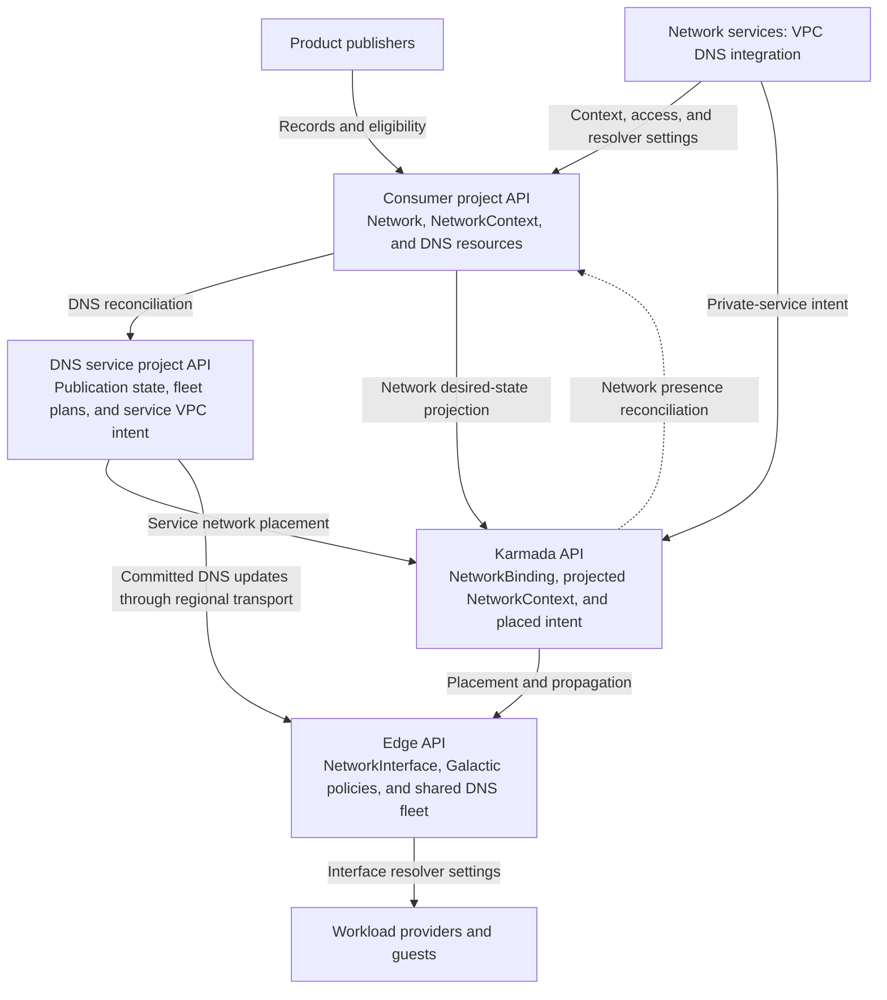
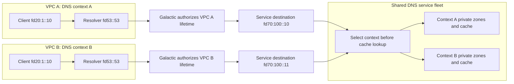

# Internal DNS for VPC resources

Tracking issue: [Internal DNS for Galactic VPC](https://github.com/datum-cloud/enhancements/issues/921).

- [Summary](#summary)
- [Motivation](#motivation)
  - [Goals](#goals)
  - [Non-Goals](#non-goals)
- [Proposal](#proposal)
  - [User stories](#user-stories)
  - [Risks and mitigations](#risks-and-mitigations)
- [Design Details](#design-details)
  - [Control-plane boundaries](#control-plane-boundaries)
  - [Network identity](#network-identity)
  - [API design](#api-design)
  - [Publication and lifecycle](#publication-and-lifecycle)
- [Production Readiness Review Questionnaire](#production-readiness-review-questionnaire)
- [Implementation History](#implementation-history)
- [Drawbacks](#drawbacks)
- [Alternatives](#alternatives)
- [Infrastructure Needed](#infrastructure-needed)

## Summary

Resources attached to a virtual private cloud (VPC) receive private DNS names and resolver settings automatically. Network services provision VPC DNS access and carry resolver settings to workload providers. Product services publish their records and endpoint eligibility.

## Motivation

Users need stable names for resources whose addresses and health change. Attaching a resource to a VPC should provide DNS access without requiring a zone choice or resolver configuration on each resource.

### Goals

- Resolve automatic resource names and multiple associated private zones within a VPC.
- Preserve tenant isolation across projects, locations, and overlapping addresses.
- Deliver resolver settings through the network-interface contract.
- Retain applied DNS access during control-plane outages and withdraw it on explicit deletion.

### Non-Goals

- Implementing DNS serving engines or Galactic packet forwarding.
- Defining Compute APIs, guest configuration mechanisms, or application health policies.
- Discovering arbitrary services on connected networks.

## Proposal

Network services provision one DNS context per enabled VPC and regional access wherever the network is used. The context selects the VPC's private zones. Workloads receive the well-known resolver address `fd53::53` through their network interfaces.

Network services selects `datum.internal` as the default domain and requests a managed namespace from DNS. DNS allocates a separate zone for each context. Product services publish records in the allocated zone. Users can associate additional private zones and naming policies through the DNS API. Shared regional fleets serve many VPCs without per-VPC deployments.

### User stories

A workload attaches to its VPC and receives resolver settings from its provider. The user queries the assigned names with the guest's default resolver:

```console
$ dig +short AAAA web-01-k7m2.datum.internal
fd20:1::10
$ dig +short AAAA database.datum.internal
fd20:1::20
$ dig +short AAAA api.prod.internal
fd20:1::30
```

The first two names represent automatic Compute and Connect publications. The third belongs to an explicitly associated custom zone. Names, suffixes, and addresses are illustrative. Public names also resolve through the VPC resolver.

### Risks and mitigations

- Cross-VPC disclosure: authorize the VPC lifetime and service destination before lookup; test overlapping names and forged identities.
- Stale configuration: preserve source lifetimes and version fences through every projection; explicit withdrawal removes access.
- Ambiguous guest routing: qualify resolver selection for workloads with multiple network interfaces before enabling that configuration.
- Forged resolver intent: resolver intent on the `NetworkContext` has no admission protection yet; see [Protecting resolver intent](#protecting-resolver-intent).

## Design Details

### Control-plane boundaries

The diagram identifies API ownership. Controllers use authenticated, project-scoped clients regardless of where their processes run.



- **Consumer project:** Owns the logical network, location-scoped network contexts, DNS resources, and product publications. Network services own DNS access intent; DNS owns serving status.
- **DNS service project:** Owns shared serving plans, publication delivery, and the DNS service's VPC. DNS controllers consume DNS intent without reading product or networking APIs.
- **Karmada:** Owns network-use declarations and propagates network and workload desired state. Resolver settings follow network presence; DNS publications use regional transport.
- **Edge:** Owns local interfaces, private-service programming reports, and serving state. Network services derive interface settings from the propagated context; providers apply them to guests.

A project UID and Network UID identify the VPC lifetime. Its network contexts share one DNS context. Network services map locations to regions through trusted platform configuration; each active region has its own access binding in the project API.

### Network identity

The DNS service runs in its own VPC. Galactic exposes an authorized private endpoint in each consumer VPC and translates its destination to a unique service-side address.



DNS selects the context from the authorized service destination before cache lookup. Client source addresses, query metadata, and client-supplied proxy headers cannot select a context. Galactic consumes generic `ServiceEndpoint` and `ServiceRoutePolicy` intent; it does not interpret DNS contexts or zones.

### API design

Network services' fields below are implemented in this repository's `networking.datumapis.com/v1alpha` API ([`internaldns_types.go`](https://github.com/datum-cloud/network-services-operator/blob/main/api/v1alpha/internaldns_types.go), [`networkcontext_types.go`](https://github.com/datum-cloud/network-services-operator/blob/main/api/v1alpha/networkcontext_types.go)) and its Internal DNS controllers. DNS owns `DNSResolverContext` and `DNSResolverAccessBinding`; their schema lives in the [dns-operator API types](https://github.com/datum-cloud/dns-operator/blob/fix/internal-dns-name-references/api/v1alpha1/internaldns_project_types.go) ([dns-operator#244](https://github.com/datum-cloud/dns-operator/pull/244)) and their contract in the [DNS architecture](https://github.com/datum-cloud/dns-operator/pull/229). This document describes what network services writes into them, not their full schema. UIDs and addresses below are illustrative.

#### Network policy

```yaml
apiVersion: networking.datumapis.com/v1alpha
kind: Network
metadata:
  name: application
spec:
  ipam:
    mode: Auto
  dns:
    # Managed is the default when the Internal DNS feature is enabled.
    # Disabled withdraws managed resolver access; see below.
    mode: Managed
```

#### DNS context and regional access

For each enabled network, network services creates one `DNSResolverContext` in the network's project namespace, owned by the `Network`:

- `spec.consumerID` is `<project UID>/<Network UID>`. Network services resolves the project UID from the Milo `Project` resource and reads the Network UID from the API server; neither comes from user input. DNS treats the value as opaque and immutable. Network services refuses to adopt an existing context whose `consumerID` or owner annotation belongs to another network lifetime.
- `spec.managedNamespace` requests `enabled: true` with `domainSuffix: datum.internal`. Network services waits until DNS reports the allocated zone and suffix in status and the context is `Ready`.

For each region the network is used in, network services creates one `DNSResolverAccessBinding`, owned by the context:

- `spec.contextRef` pins the context's name and UID.
- `spec.region` is the region key. Network services reads it from the `topology.datum.net/region` entry of the `NetworkContext`'s `Location`, for example `us-central-1`. DNS accepts only a region that matches one of its configured serving regions exactly, so the platform's location topology and the DNS fleet configuration must use the same keys. A location without the key gets no access; a key DNS does not serve leaves the binding `Accepted=False`.
- `spec.destinationAddress` is the service-side address Galactic maps the VPC's resolver traffic to. Network services allocates it: the address is the configured `internalDNS.servicePrefix` (default `fd70:100::/64`) with its low 64 bits taken from a SHA-256 of the `DNSResolverContext` UID. The address is stable for the context lifetime and the same in every region. A recreated network gets a new context UID and therefore a new address.

DNS does not allocate the destination; it reserves it. Before accepting a binding, DNS atomically claims the region, address, and port 53 across every project on the DNS service and rejects the binding (`Accepted=False`, reason `InvalidOrStaleAccess`) if another context lifetime holds the claim, or if the address falls inside DNS's own regional resolver pool. Claims are retained after withdrawal, so an address is never reused by a later context lifetime. Context, region, and destination are immutable per binding; network services deletes and recreates a binding whose fields no longer match.

> [!NOTE]
> Open question: a hash collision between two context UIDs leaves the second binding rejected, and network services has no fallback allocation for it. The 64-bit space makes this unlikely, but the context stays without DNS access until an operator intervenes.

Network services publishes resolver settings only after DNS reports the current binding generation `Ready` and Galactic reports the corresponding policy programmed on the required nodes.

#### Resolver settings delivered to workloads

Network services carries resolver intent through federation on the `NetworkContext` and delivers effective settings on each `NetworkInterface`. Each object has one writer:

1. The project controller records the DNS context name, access binding name, service destination, suffix, and region as `networking.datumapis.com/internal-dns-*` annotations on the project's `NetworkContext`. Replication carries exactly these annotations to the hub and the cell.
2. In the cell, network services reads the annotations, programs Galactic `ServiceEndpoint` and `ServiceRoutePolicy` objects for UDP and TCP to the service destination, and reports `status.dnsAccess` and `DNSReady` once Galactic acknowledges the path.
3. When the hub's `status.dnsAccess` matches the recorded intent and `DNSReady` is true, network services writes `NetworkContext.spec.dns` in the project. While the proof is missing or stale, it keeps settings that still match the intent and clears settings that do not, so an outage of the verification path does not reconfigure guests.
4. The interface controller copies the nameservers and search domains from `spec.dns` into `NetworkInterface.status.dns`. Consumers cannot set DNS on an interface.
5. The provider applies `status.dns` and reports `DNSConfigured` on the interface.

```yaml
apiVersion: networking.datumapis.com/v1alpha
kind: NetworkContext
metadata:
  name: application-us-central-1
  annotations:
    # Written by network services in the project; replicated to hub and cell.
    networking.datumapis.com/internal-dns-context-name: dns-application-4f1c2a9b7e01
    networking.datumapis.com/internal-dns-access-name: dns-application-4f1c2a9b7e01-us-central-1-91d0c3aa5b27
    networking.datumapis.com/internal-dns-service-destination: fd70:100::8c2e:41f0:9a1b:77d3
    networking.datumapis.com/internal-dns-suffix: datum.internal
    networking.datumapis.com/internal-dns-region: us-central-1
spec:
  network:
    name: application
  location:
    name: us-central-1
  # Written by network services only after the private path is verified.
  dns:
    contextRef:
      name: dns-application-4f1c2a9b7e01
    accessBindingRef:
      name: dns-application-4f1c2a9b7e01-us-central-1-91d0c3aa5b27
    nameservers: ["fd53::53"]
    searches: [datum.internal]
status:
  dnsAccess:
    contextRef:
      name: dns-application-4f1c2a9b7e01
    accessBindingRef:
      name: dns-application-4f1c2a9b7e01-us-central-1-91d0c3aa5b27
    serviceDestination: fd70:100::8c2e:41f0:9a1b:77d3
  conditions:
    - type: DNSReady
      status: "True"
      reason: Ready
---
apiVersion: networking.datumapis.com/v1alpha
kind: NetworkInterface
metadata:
  name: web-01-eth0
spec:
  network:
    name: application
  interfaceName: eth0
status:
  # Effective settings, read-only to consumers.
  dns:
    nameservers: ["fd53::53"]
    searches: [datum.internal]
  conditions:
    # Reported by the provider after applying the effective settings.
    - type: DNSConfigured
      status: "True"
      reason: Applied
      message: Resolver settings are configured
      lastTransitionTime: "2026-10-13T13:00:00Z"
```

`DNSConfigured` uses reason `Applied` when the provider has applied the current settings and `UnsupportedMultipleContexts` when it refuses an interface set that spans more than one managed DNS context. Both reasons are defined in this repository's API; providers use the same values.

#### Protecting resolver intent

The `NetworkContext` lives in the consumer project, and the cell trusts its replicated annotations when it programs the Galactic path. The protections today are:

- `consumerID`, the context and binding names, and the service destination are computed by network services from server-side identities. No user-supplied field feeds them.
- The shipped consumer roles (`networking.datumapis.com-viewer` and `networking.datumapis.com-admin`) grant only `get`, `list`, and `watch` on `NetworkContext`. Consumers cannot write `spec.dns`, the annotations, or status through them.
- DNS binds each destination to one context lifetime, and Galactic authorizes only the VPC the cell pins in the policy.

> [!WARNING]
> Open gap: no admission check protects these fields. The `NetworkContext` protected resource exposes `update` and `patch`, so a project member granted those permissions through a custom role could edit the annotations. Setting the service-destination annotation to another context's destination would make the cell program a path from this VPC to that context's DNS view; pointing the access-binding annotation at another binding changes which binding the readiness check compares against. Before enablement outside staging, this needs both an admission policy in the project API that rejects changes to the `internal-dns-*` annotations and `spec.dns` from any identity other than the network services controller, and a cell-side check that the destination matches the binding DNS accepted for this context instead of trusting the annotation alone.

#### Disabling DNS on a network

`Network.spec.dns.mode: Disabled` is accepted at any time, including while workloads are running; the API does not check for attached interfaces. Network services then deletes the region's access bindings and the `DNSResolverContext`, which removes the managed zone and its records, and clears the annotations and `spec.dns` on every context. Interfaces lose `status.dns`, and providers must remove the managed resolver from guests. Because `fd53::53` is the only resolver network services configures, a running guest loses all DNS through it, public names included; this design does not supply a fallback resolver. Re-enabling creates a new context lifetime with a new service destination, and products republish their names into the new zone.

> [!NOTE]
> Open question: whether `Disabled` should be refused while interfaces are attached, or whether providers should fall back to a public resolver after an explicit disable. A transient failure must never trigger that fallback.

#### Guests and resolver availability

The initial guest contract supports one managed DNS context. Interfaces on the same VPC receive identical settings. A guest whose interfaces span more than one managed VPC is unsupported: the provider reports `DNSConfigured=False` with `UnsupportedMultipleContexts` rather than merge resolver settings, and the guest receives no managed resolver until the combination is resolved.

If the regional DNS fleet is unavailable, guests behind `fd53::53` get no answers for any name, private or public, until it recovers. Network services does not configure a second resolver or redirect queries to a public resolver, because that would leak private names and return wrong answers for private zones. Applied Galactic paths and interface settings stay in place through the outage, so resolution resumes without reconfiguring guests. Multi-NIC guests are affected the same way, since they have at most one managed resolver. There is no cross-region failover in the initial design.

### Publication and lifecycle

Products reserve names through `DNSRegistration` and publish eligible addresses through `DNSRecordContribution`. Project RBAC authorizes product publication; publisher credentials cannot program resolver access. Compute owns instance and service eligibility; Connect owns export eligibility. DNS and network services do not inspect Compute resources.

Reconcile access, publication, and settings independently per project and region. Use conditional writes and resume reconciliation from stored intent after takeover. Failure in one region must not block healthy regions. Galactic verifies network lifetimes and current programming; DNS owns publication ordering.

Products explicitly withdraw unhealthy endpoints. Unavailable observations retain the last reported endpoint state. Withdrawal bounds include cached-answer TTLs. Removing a location's last consumer clears its settings; removing the region's last consumer withdraws access. Network deletion retires the DNS context. Recreated networks and retained interfaces cannot inherit retired access mappings.

## Production Readiness Review Questionnaire

### Feature Enablement and Rollback

Gate VPC integration and product publication separately, disabled by default for alpha. Enable selected staging projects first. Explicit withdrawal removes private paths and guest settings through provider reconciliation. Withdraw access before disabling integration; stopping controllers retains applied settings and paths.

### Rollout, Upgrade and Rollback Planning

Extend the shared network services federation and DNS Kubernetes test environments. Release acceptance requires guest-default queries from two VPCs with overlapping names and addresses, over UDP and TCP. Test takeover, replay, API and broker outages, health withdrawal, deletion, and rollback. Public DNS must follow the configured resolution policy.

### Monitoring Requirements

Measure reconciliation failures, guest-configuration time, and withdrawal latency. Users can inspect assigned names and DNS readiness. Operators trace context, access, route programming, interface, and serving reports.

### Dependencies

Require DNS serving and project APIs, authenticated clients, trusted federation metadata, Galactic private connectivity, and providers that refresh resolver settings. During API outages, applied private-service access and resolver settings persist. New settings require verified programming; unavailable observations report unknown readiness.

### Scalability

Locations sharing a regional path share access. Interface settings scale with interfaces; publications scale with endpoints. Qualify reconciliation throughput, controller sharding, and bounded search lists before increasing the canary cohort.

### Troubleshooting

Inspect `DNSReady` and `DNSConfigured`, then trace network, context, access, and route readiness. Querying an explicit resolver address does not verify guest configuration.

## Implementation History

This enhancement is provisional. Release acceptance criteria require qualification before enablement.

## Drawbacks

Guest DNS readiness depends on both serving and private connectivity. Event-driven access changes and interface projection require bounded fan-out.

## Alternatives

Users can configure resolvers and publish static records manually. That approach does not provide automatic names or health-driven withdrawal.

## Infrastructure Needed

Shared regional DNS fleets in a service VPC, protected publication transport, producer VPC attachments, and consumer private endpoints. Use the [staging preparation stack](https://github.com/datum-cloud/infra/pull/6862) as the infrastructure boundary.

Related designs: [network presence](../network-in-every-location.md), [network interfaces](../network-interfaces.md), [internal DNS](https://github.com/datum-cloud/dns-operator/pull/229), and [Private Service Connect](https://github.com/datum-cloud/galactic/blob/main/docs/enhancements/networking/private-service-connect/README.md).
