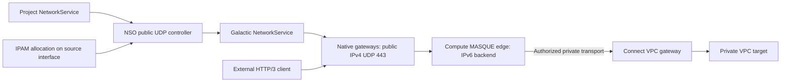

# Native public UDP publication

A project can publish a single UDP port on one Compute network interface through the native Galactic fabric. This provides the network primitive for a separate public MASQUE edge; Connect remains responsible for its identity, gateway grants, authentication, DNS, certificates and packet-level readiness. The publisher does not terminate QUIC or TLS, interpret CONNECT-IP, or grant access to a VPC gateway.



## API and scope

See [the service example](../../config/samples/networking_v1alpha_networkservice_public_udp.yaml). `publicUDP` requires exactly one UDP port; that number is both the public and backend port. Its location and address class are immutable once enabled. Delete the service to withdraw publication. TCP services keep their existing default, and HTTPProxy rejects a UDP backend.

The selector must resolve to exactly one projected interface in the project's namespace and requested location. The source cell namespace must identify the same upstream project and namespace. The publisher checks the source interface's network and labels, live claim, current allocation/programming/holder conditions, and ownership of its Galactic attachment. It only uses an allocated, globally scoped IPv4 address of class `public-ipv4`; the project cannot supply a VIP directly. Unknown, unhealthy, ambiguous, releasing or foreign backends cause withdrawal. The controller never creates an attachment or grants a project access to another project's interfaces.

`status.publicAddresses` reports the selected allocation. Wait for **PublicReady**, with the current observed generation, for public publication. The pre-existing **Ready** condition describes membership and does not attest public reachability. PublicReady follows the native service's current Ready condition; it is not an external packet probe. An application such as Connect must separately test the public endpoint and authorized backend packet round trip.

## Deployment prerequisites

1. Install this release's CRDs and both the hub and cell NSO controllers through deployment PRs. The cell address-release protection must be running **before** enabling the publisher.
2. Deploy a Galactic version with `galactic.datumapis.com/v1alpha1` NetworkService and ServiceVIPBinding support, IPv4 VIP to IPv6 backend translation, binding cleanup and route-withdrawal finalizers. This integration was inspected against Galactic commit `dcad93c7`. It does not use the retired NetworkRule API.
3. Enable `GALACTIC_GATEWAY_IPV4_VIPS=true` on the native gateways and grant their service identities get/list/watch on ServiceVIPBindings as required by Galactic. Ensure the public IPv4 pool is routable through those gateways. This is a separately reviewed infrastructure change.
4. Request `public-ipv4` in the Compute interface's address classes, in addition to its IPv6 address family. Keep one stable interface claim per edge instance. The publisher consumes that allocation; it does not create a second IPAM allocation. Instance replacement retaining the claim keeps the same public address. Claim deletion follows its reclaim policy.
5. Render [the project role](../../config/public-udp/project) against the selected project API and [the cell deployment](../../config/public-udp/cell) against the native cell. Replace the image, project, location and controller identity placeholders through an overlay. Use one publisher deployment per project, namespace and location, with a unique deployment/service-account name when sharing a cell. Keep only one elected leader for that scope.
6. Supply `public-udp-project-credentials` through the platform's managed credential issuer. Its `kubeconfig` must address the selected project API and use the dedicated, project-scoped identity in the example role binding. Mount any referenced certificate, key and CA as additional files in that Secret, or overlay the volume with the platform's rotating certificate projection. Do not reuse a root controller identity. Restart the publisher when credentials that client-go does not reload change. The cell client uses the pod's service account; no project credentials are embedded in the image or manifests.

The example cell RBAC is privileged infrastructure configuration: publication needs to validate source namespaces and update interface holds and attachment selector labels across tenant namespaces. Only the operator should deploy or configure the publisher. The project credential only needs the namespace-scoped operations in the example role; Milo deployments must also grant their equivalent project IAM permissions through the platform's reviewed identity configuration. No load-balancer Service, GKE data path, TLS private key or bearer token is needed by the publisher.

Render before submitting a deployment PR:

```sh
bin/kustomize build config/public-udp/project
bin/kustomize build config/public-udp/cell
```

## Withdrawal, changes and recovery

The publisher owns a native service named from the project service UID, an attachment selector label and an allocation hold on the source interface. It rejects a native resource with conflicting ownership. Project deletion, backend loss and selector changes withdraw the native service. The native controller withdraws advertisements under its own finalizer; each gateway separately retains its datapath entry for its drain delay. Native service deletion is not an acknowledgement that every gateway has removed its local entry. The publisher waits for that service **and its ServiceVIPBindings** to disappear before removing the allocation hold and selector label. Port/backend changes withdraw the old publication before creating its replacement, so changes can interrupt active UDP sessions.

NSO marks an interface as beginning address release with an optimistic resource-version write before calling IPAM. Publication refuses this marker, while address release waits for every public UDP hold to clear. This prevents IPAM release ahead of the native withdrawal finalizer and translation-binding cleanup. Completion of gateway-local draining still follows the Galactic contract; verify that ordering in the native staging test before enabling this capability generally. A controller outage can therefore retain an allocation; that is intentional. Restore the publisher/native controllers and let withdrawal finish rather than stripping finalizers.

Keep the publisher deployed until all public services and holds are gone. Roll back by deleting the project services, waiting for native withdrawal and IPAM cleanup, then removing the publisher. Do not downgrade the cell controller while public holds exist. Existing TCP resources need no migration.

## Operations and verification

The controller polls dependent cell state every five seconds, uses leader election, and exposes controller-runtime reconciliation/error metrics on `127.0.0.1:9082` by default. The metrics address is configurable; restrict access if exposing it to a scraper. `/readyz` on port 9083 checks process readiness; per-service PublicReady checks native programming. The example bounds CPU/memory and allows graceful controller shutdown. Reconciliation logs contain resource names and errors, not credentials. A blocked backend reports BackendUnavailable; pending native programming reports Programming, and withdrawal reports Withdrawing or BackendChanging.

Unit and API-server tests cover tenant and attachment ownership, stale conditions, invalid UDP configurations, HTTPProxy rejection, preservation of publication status, native finalizer/binding ordering and delayed IPAM release. These do not replace a native dataplane test.

The staging acceptance gate remains pending the deployment PRs: create a managed Connect edge, dial its managed hostname from outside Datum on UDP 443, receive HTTP 200 plus an address and route using an independent CONNECT-IP client, exchange a packet with a private VPC target, reject an unauthorized request, revoke access, and confirm native withdrawal and allocation cleanup. A QUIC handshake or PublicReady alone is not acceptance. No managed external packet-round-trip success is claimed by this change.
